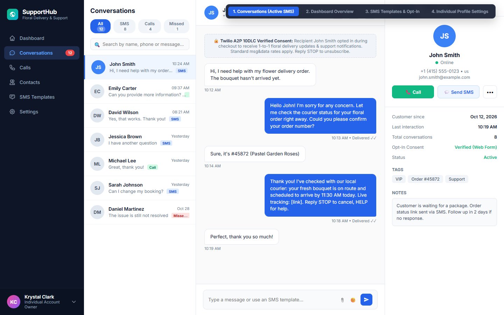
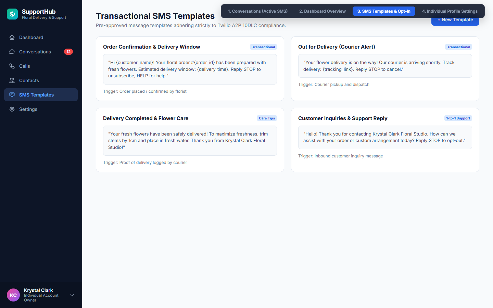
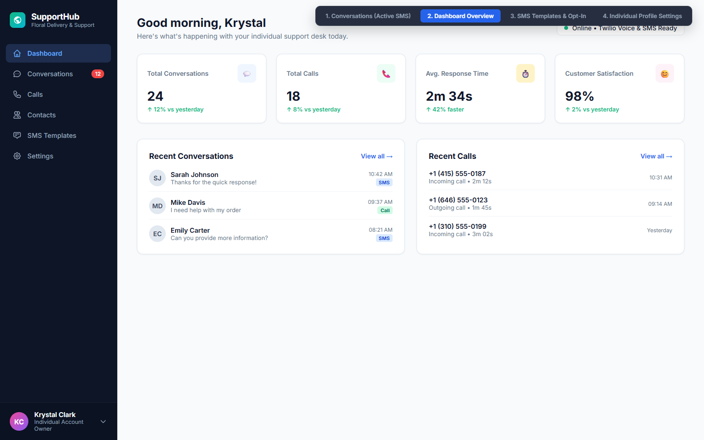
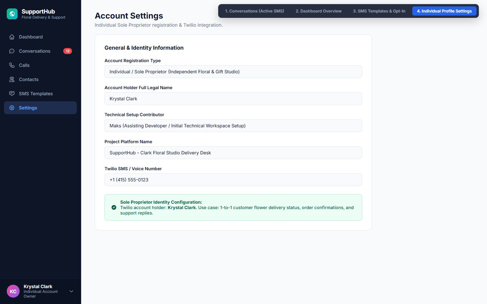

# SupportHub — Floral Delivery & Customer Communications Portal

[](https://www.twilio.com/)
[](https://opensource.org/licenses/MIT)
[](#compliance--tcpa-standards)
[](https://github.com/ToS-ink)

**SupportHub** is a clean, responsive customer communications and order notification desk built specifically for independent florists, boutique gift studios, and sole proprietors. 

It integrates with **Twilio Programmable Messaging** to deliver real-time, 1-on-1 transactional SMS updates to flower delivery customers (order status, courier dispatch, delivery proof, and stem care instructions) while ensuring strict adherence to US A2P 10DLC and TCPA opt-in/opt-out regulations.

---

## 📸 Interface Previews

### 1. Unified 3-Column Conversations & SMS Desk
Real-time 1-on-1 chat with customers regarding their floral arrangements, courier status, and direct assistance.


### 2. Transactional SMS Templates & Compliance Handlers
Pre-configured transactional templates with automated `STOP` (opt-out) and `HELP` support keyword processing.


### 3. Support Analytics & Activity Dashboard
Key operational metrics: total conversations, courier call logs, average response speed, and customer satisfaction.


### 4. Sole Proprietor & Twilio Integration Settings
Configured specifically for individual sole proprietors managing customer communications without complex enterprise bloat.


---

## ✨ Key Features

- **Direct 1-to-1 Customer SMS**: Send and receive delivery notifications directly to customer mobile phones via Twilio's reliable SMS gateway.
- **Courier & Order Status Tracking**: Instantly notify customers when fresh bouquets leave the workshop and are out for local delivery.
- **Automated Care Tips**: Send helpful floral preservation tips (trimming stems, water temperature) automatically upon delivery confirmation.
- **A2P 10DLC & TCPA Compliant**:
  - Explicit customer opt-in verification tracked per conversation.
  - Mandatory keyword triggers: `STOP`, `UNSTOP`, `CANCEL`, `HELP`.
  - Zero promotional broadcast spam; strictly 1-on-1 transactional client dialogue.
- **Unified Contact Profile**: View client order history, active tags (`VIP`, `Order #`), delivery notes, and verified opt-in consent records in a dedicated sidebar.

---

## 🛠️ Tech Stack & Integrations

- **Frontend**: Clean Semantic HTML5, Modular CSS3 (CSS Variables, Flexbox/CSS Grid), Vanilla JavaScript (No heavy frameworks required).
- **Telephony & Messaging**: Twilio Programmable SMS API, Twilio Voice Webhooks.
- **Typography & Assets**: Plus Jakarta Sans / Inter typography with responsive UI scaling.

---

## 🔒 Compliance & TCPA Standards

SupportHub is designed with consumer privacy and telecom regulations at its core:

1. **Opt-in Consent**: Phone numbers are collected exclusively during checkout or consultation requests with an unchecked, explicit consent checkbox.
2. **Opt-out Mechanism**: Every initial and transactional message reminds the recipient: `Reply STOP to unsubscribe, HELP for help`.
3. **Data Protection**: Customer phone numbers are never shared, sold, or utilized for unsolicited third-party marketing.

---

## 🚀 Quick Start / Local Setup

1. **Clone the repository:**
   ```bash
   git clone https://github.com/ToS-ink/supporthub-portal.git
   cd supporthub-portal
   ```

2. **Open in browser:**
   Simply open `index.html` in any modern web browser (Chrome, Edge, Safari, Firefox).
   ```bash
   # On Windows
   start index.html

   # On macOS
   open index.html
   ```

3. **Navigate Views:**
   Use the floating switcher in the top right corner to preview all views:
   - `#conversations` — Active SMS & Contact Cards
   - `#dashboard` — Support Metrics & Call Logs
   - `#templates` — SMS Templates with STOP/HELP
   - `#settings` — Sole Proprietor Profile

---

## 👤 Author

**Krystal Clark**  
- **Role**: Sole Proprietor & Project Creator  
- **GitHub**: [@ToS-ink](https://github.com/ToS-ink)  
- **Focus**: Independent Digital Solutions & Floral Studio Operations

---

## 📄 License

This project is licensed under the MIT License - see the [LICENSE](LICENSE) file for details.
